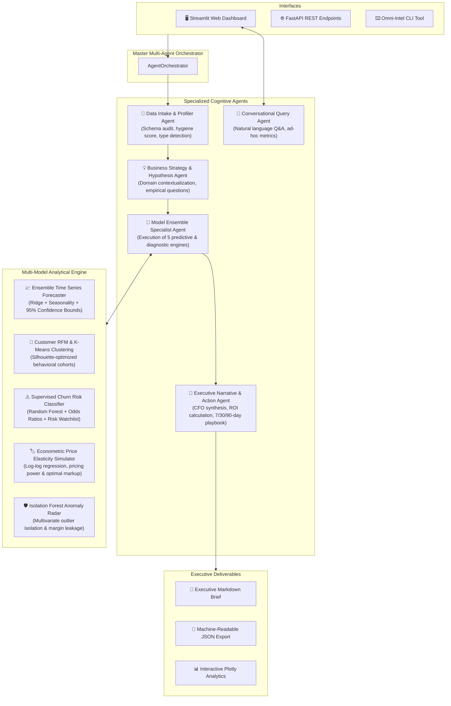

# ⚡ OmniInsight AI: Autonomous Multi-Model Data Intelligence for SMBs

[](https://www.python.org/downloads/)
[](https://fastapi.tiangolo.com/)
[](https://streamlit.io/)
[](https://opensource.org/licenses/MIT)
[]()

> **Turning messy business spreadsheets and transactional databases into predictive demand forecasts, customer retention radars, econometric pricing power, and executive action playbooks with autonomous AI agents.**

---

## 🎯 Executive Overview & Problem Statement

Small and Medium Businesses (SMBs) across retail, SaaS, and hospitality capture vast amounts of operational data (order histories, subscription accounts, daily POS covers, and margin sheets). However:
- **92% of SMBs lack dedicated data science or ML engineering staff.**
- Traditional BI tools (PowerBI, Tableau) only show *historical aggregates* without explaining **why** metrics changed or **what actions to take next**.
- Machine learning models remain trapped in complex Jupyter notebooks inaccessible to business founders and operators.

**OmniInsight AI** bridges this divide by deploying a collaborative team of specialized autonomous agents that ingest raw business data, execute a multi-model mathematical suite, quantify immediate dollar opportunities, and generate prioritized 7-day, 30-day, and 90-day executive action playbooks.

---

## 🏗️ Multi-Agent Architecture



---

## 🤖 The Autonomous Multi-Agent Team

| Agent | Responsibility | Key Output |
| :--- | :--- | :--- |
| **Data Intake & Profiler Agent** | Audits dataset completeness, uniqueness, consistency, and detects semantic column roles (dates, revenue, IDs, categories). | 0–100 Data Hygiene Score, Sanitized DataFrame, Transformation Audit Log. |
| **Strategy & Hypothesis Agent** | Formulates empirical, high-leverage business questions tailored to the business type (Retail, SaaS, Restaurant). | Prioritized Hypotheses Matrix with target metrics. |
| **Model Ensemble Specialist Agent** | Dynamically routes data through mathematical models, tunes parameters, and validates statistical metrics. | Model metrics (MAPE, $R^2$, Silhouette, ROC-AUC), parameter payloads, and charts data. |
| **Executive Narrative Agent** | Virtual "AI Chief Strategy Officer" translating ML findings into plain English, quantified ROI, and departmental ownership. | Quantified $ value opportunity, 7-day, 30-day, and 90-day Action Playbook. |
| **Conversational Query Agent** | Natural language business interface allowing operators to ask ad-hoc questions without writing SQL or Python. | Plain-English answers, live aggregated tables, and KPI cards. |

---

## 🔬 Multi-Model Statistical & ML Suite

1. **Ensemble Time Series & Demand Forecaster**:
   - Decomposes day-of-week seasonality, polynomial growth trends, and calendar features using Ridge regression and exponential smoothing.
   - Outputs 30/60/90-day forward projections with 95% uncertainty confidence intervals and Mean Absolute Percentage Error (MAPE) validation.
2. **Customer RFM & Behavioral Clustering**:
   - Calculates Recency, Frequency, and Monetary scores per customer account.
   - Normalizes log-transformed features and performs K-Means clustering with optimal Silhouette score selection ($k \in [3, 5]$).
   - Automatically maps clusters into actionable personas: *Champions & VIPs*, *Loyal High-Value*, *Promising Newcomers*, *At-Risk Accounts*, and *Hibernating*.
3. **Supervised Churn Prediction & Retention Risk Radar**:
   - Supervised Random Forest and Logistic Regression classifier predicting account attrition probability.
   - Extracts top feature importance drivers (e.g. low login frequency, support ticket volume) and generates a prioritized **High-Risk Watchlist** with total dollars at risk.
4. **Econometric Price Elasticity Simulator**:
   - Fits log-log demand regression: $\ln(Q) = \alpha + \epsilon \cdot \ln(P) + \beta X$.
   - Diagnoses price elasticity of demand ($\epsilon$): Inelastic (strong pricing power; safe to raise prices 5–8%), Elastic (price sensitive; optimize bundling), or Unitary.
5. **Operational & Financial Anomaly Radar**:
   - Unsupervised Isolation Forest detecting multivariate anomalies, inventory leakage, billing errors, or abnormal labor cost ratios.

---

## 📦 Supported SMB Benchmark Domains

OmniInsight comes with realistic synthetic data generators capturing real-world business dynamics:

- **🛒 Retail & Multi-Channel E-Commerce** (`data/samples/retail_ecommerce_sales.csv`):
  - 3,500 transactions, customer IDs, product categories, unit prices, discounts, margins, and channels (Online, POS, Marketplace).
- **💻 B2B SaaS & Subscription Services** (`data/samples/saas_customer_retention.csv`):
  - 1,200 accounts, plan tiers, MRR, seats active vs purchased, login frequency, support tickets, NPS, tenure, and churn labels.
- **🍽️ Hospitality & Restaurant Operations** (`data/samples/restaurant_operations.csv`):
  - 650 operational days, diner covers, average check size, dine-in vs delivery revenue, food costs, labor costs, turnover, and weather conditions.

---

## 🚀 Quickstart Guide

### 1. Installation

```bash
# Clone the repository
git clone https://github.com/abhiramtarungeddam/Data_intelligence.git
cd Data_intelligence

# Create and activate virtual environment
python3 -m venv venv
source venv/bin/activate

# Install dependencies
pip install -r requirements.txt
pip install -e .
```

### 2. Launch the Streamlit Web Dashboard

```bash
omni-intel serve-ui
# Or directly:
streamlit run data_intelligence/ui/app.py --server.port 8501
```
Open [http://localhost:8501](http://localhost:8501) in your browser. Choose any demo dataset or upload your own CSV/Excel to trigger the autonomous multi-agent audit!

### 3. Launch the FastAPI REST Server

```bash
omni-intel serve-api --port 8000
```
- Interactive Swagger API Docs: [http://localhost:8000/docs](http://localhost:8000/docs)
- Alternative ReDoc: [http://localhost:8000/redoc](http://localhost:8000/redoc)

### 4. Command-Line Interface (CLI)

```bash
# Run multi-agent audit on any dataset and export executive reports
omni-intel analyze --file data/samples/retail_ecommerce_sales.csv --export

# Query dataset in plain English
omni-intel query --file data/samples/retail_ecommerce_sales.csv --question "What was our total revenue?"
omni-intel query --file data/samples/retail_ecommerce_sales.csv --question "Who is our top customer?"

# Generate fresh synthetic benchmark datasets
omni-intel generate-samples
```

### 5. Run with Docker Compose

```bash
docker compose up --build
```
- REST API: `http://localhost:8000`
- Streamlit UI: `http://localhost:8501`

---

## 🐍 Python SDK Usage

```python
from data_intelligence.agents.orchestrator import AgentOrchestrator
import pandas as pd

# Initialize multi-agent orchestrator
orchestrator = AgentOrchestrator()

# Run full audit from file or dataframe
report = orchestrator.run_from_file("data/samples/retail_ecommerce_sales.csv")

# Access executive summary and quantified ROI
print(f"Data Health: {report.dataset_profile.data_quality.overall_score}/100")
print(f"Quantified Opportunity: ${report.executive_summary.quantified_roi_opportunity:,.2f}")
print("7-Day Immediate Actions:")
for item in report.executive_summary.playbook_7_days:
    print(f"- [{item.department}] {item.title}: ${item.estimated_impact_dollars}")
```

---

## 🧪 Automated Test Suite

OmniInsight is backed by an automated unit and end-to-end integration test suite:

```bash
source venv/bin/activate
pytest -v
```

```
tests/test_agents.py::test_hypothesis_agent PASSED
tests/test_agents.py::test_conversational_query_agent PASSED
tests/test_api.py::test_api_health PASSED
tests/test_api.py::test_api_samples_list PASSED
tests/test_api.py::test_api_sample_audit PASSED
tests/test_api.py::test_api_query PASSED
tests/test_models.py::test_forecaster_engine PASSED
tests/test_models.py::test_customer_segmentation_engine PASSED
tests/test_models.py::test_churn_engine PASSED
tests/test_models.py::test_elasticity_engine PASSED
tests/test_models.py::test_anomaly_engine PASSED
tests/test_pipeline.py::test_end_to_end_retail_pipeline PASSED
tests/test_pipeline.py::test_end_to_end_saas_pipeline PASSED
tests/test_profiler.py::test_data_profiler_semantics PASSED
tests/test_profiler.py::test_data_cleaner PASSED

======================== 15 passed in 1.91s =========================
```

---

## 📂 Project Directory Structure

```
Data_intelligence/
├── data/
│   └── samples/                   # Pre-generated SMB benchmark datasets
│       ├── retail_ecommerce_sales.csv
│       ├── saas_customer_retention.csv
│       └── restaurant_operations.csv
├── data_intelligence/
│   ├── agents/                    # Autonomous AI Agent team
│   │   ├── base.py                # Base agent lifecycle & telemetry
│   │   ├── profiler_agent.py      # Data intake & hygiene profiler
│   │   ├── hypothesis_agent.py    # Strategic hypothesis generator
│   │   ├── specialist_agent.py    # Multi-model ensemble coordinator
│   │   ├── executive_agent.py     # CFO executive narrative & playbooks
│   │   ├── query_agent.py         # Conversational Q&A assistant
│   │   └── orchestrator.py        # Master pipeline orchestrator
│   ├── core/                      # Data engineering core
│   │   ├── profiler.py            # Type & semantic role detection
│   │   └── cleaner.py             # Deduplication, imputation, sanitization
│   ├── data/                      # Synthetic data generators
│   │   └── generator.py           # Domain data generators
│   ├── models/                    # Analytical ML & Statistical engines
│   │   ├── forecaster.py          # Time series & demand forecasting
│   │   ├── segmentation.py        # Customer RFM & K-Means clustering
│   │   ├── churn.py               # Supervised churn risk classification
│   │   ├── elasticity.py          # Price elasticity & pricing power
│   │   └── anomaly.py             # Isolation Forest anomaly radar
│   ├── reporting/                 # Executive report generators
│   │   ├── markdown_report.py     # Executive brief Markdown builder
│   │   └── exporter.py            # File persistence (MD & JSON)
│   ├── api/                       # FastAPI REST service
│   │   ├── main.py                # Application entrypoint & CORS
│   │   ├── routes.py              # Endpoints (/audit, /query, /samples)
│   │   └── schemas.py             # Pydantic request & response models
│   ├── ui/                        # Streamlit web application
│   │   ├── app.py                 # Interactive dashboard
│   │   └── visualizations.py      # Plotly chart generators
│   ├── cli.py                     # Command-line interface
│   ├── config.py                  # Environment & paths configuration
│   └── types.py                   # Pydantic schemas & domain models
├── reports/                       # Generated audit reports
├── tests/                         # Pytest test suite
├── Dockerfile                     # Production container spec
├── docker-compose.yml             # API & Dashboard service orchestration
├── pyproject.toml                 # Package configuration
├── requirements.txt               # Locked dependencies
└── README.md                      # Platform documentation
```

---

## 📄 License

This project is licensed under the MIT License - see the LICENSE file for details.
